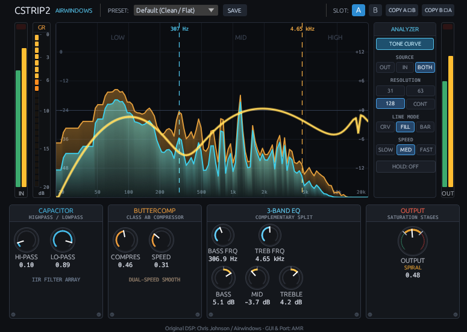

# CStrip2 Visual

**Version:** `v0.1.0`  
**License:** [GNU General Public License v3.0 or later (`GPL-3.0-or-later`)](LICENSE)  
**Formats:** Windows (`x86_64`) **VST3 & CLAP** · macOS (`Universal 2`: `arm64` & `x86_64`) **VST3, CLAP & AUv2**  
**Original DSP:** [Chris Johnson / Airwindows](https://www.airwindows.com) (MIT License) · **Visual Interface & Rust Port:** AMR

**[Download Latest Release (`v0.1.0`)](../../releases)** · **[Documentation (`docs/`)](docs/)** · **[Changelog](CHANGELOG.md)** · **[Español](#español)**

---

## Overview

**CStrip2 Visual** brings the musical character of **Chris Johnson's (Airwindows) CStrip2** channel strip into a clear, modern visual workflow. Designed for everyday mixing and production, it combines four essential tone-shaping stages in a single window:

* **Clean up the extremes** with smooth high-pass and low-pass filters (**Capacitor**).
* **Control dynamics and peaks** with a responsive, program-dependent compressor (**ButterComp**).
* **Sculpt lows, mids, and highs** using a 3-band equalizer with adjustable crossover frequencies (**3-Band EQ**).
* **Set your final level or add warmth** with an output stage (**Output**) that transitions smoothly from clean unity gain into progressive **Spiral** and **Density** harmonic saturation.

You can adjust the processing stages to suit each track, monitor the results using the real-time stereo spectrum analyzer and interactive Tone Curve, and use the built-in A/B slots to compare different parameter settings.


*CStrip2 Visual in use: real-time stereo spectrum analyzer (`IN`/`OUT`/`BOTH`), interactive Tone Curve, metering, and four processing modules.*

---

## DSP Signal Chain & Technical Reference

Built in Rust with **NIH-plug** and **egui**, the audio engine ports the Airwindows CStrip2 algorithms across four processing stages accompanied by a lock-free visual analysis engine:

### 1. Capacitor (Input High-Pass / Low-Pass Filters)
* Port of the Airwindows **Capacitor** input filter stage (`Hi-Pass` and `Lo-Pass`).
* **Implementation:** Non-linear 6-stage interleaved IIR filter array (`count: 0..5`) evaluated sample-by-sample.
* *Technical note:* Uses the dedicated Airwindows Capacitor algorithm rather than conventional Butterworth filter topologies.

### 2. ButterComp (Class AB Dynamic Compressor)
* Port of the original Airwindows **ButterComp** non-linear dynamic compressor (`Compres` and `Speed`).
* **Implementation:** Sample-by-sample bipolar flip/flop alternation (`flip = !flip`), independent asymmetric tracking of positive and negative signal halves, golden-ratio weighted moving average (`0.6180339887...`), and dual-speed smoothing.
* *Technical note:* Does not include an expander or noise gate stage, and follows the distinctive Airwindows ButterComp character rather than a conventional VCA/mastering bus compressor topology.

### 3. 3-Band Complementary Split EQ
* Three bands: **Bass** (with adjustable crossover `Bass Frq`), **Mid**, and **Treble** (with adjustable crossover `Treb Frq`).
* **Implementation:** Logarithmic density-to-dB mapping, consecutive sample-difference filtering, and non-linear cubic harmonic correction (*triplet factor*).
* Interactive crossover markers (`LOW`, `MID`, `HIGH`) and draggable band handles on the graphical display.

### 4. Output Stage (Saturation & Floating Point Dither)
* **Output Gain & Saturation:** `Output` control (`0.0` to `1.0` normalized, corresponding to `0x`–`3x` gain). Unity gain is at approximately **`0.333`** (one third of the control range, with **`0.33`** as the control's default value). Driving `Output` above unity progressively engages Airwindows **Spiral** and **Density** harmonic saturation stages.
* **Dither:** Final **Airwindows Floating Point Dither** output stage.

### 5. Real-Time Spectrum Analyzer, Tone Curve & Workflow Controls
* **Zero-Allocation Audio Thread:** Lock-free ring buffer transfer from the real-time audio thread to the GUI FFT worker.
* **Tone Curve Overlay:** Real-time theoretical frequency-response curve showing the combined **Capacitor + 3-Band EQ** transfer function across `20 Hz – 20 kHz`.
* **Analyzer Controls:**
  * **Source:** `OUT`, `IN`, or `BOTH` (simultaneous orange Input and cyan Output overlay).
  * **Resolution:** `31` bands, `63` bands, `128` points, or `CONT` (continuous).
  * **Line Mode:** `CRV` (curve), `FILL` (filled area), or `BAR` (bars).
  * **Speed & Hold:** `SLOW`, `MED`, `FAST` decay presets and peak `HOLD` toggle.
* **Metering & State Management:** Stereo `IN` and `OUT` peak/RMS meters, dedicated `GR` (ButterComp gain reduction) meter (`0` to `-20 dB`), built-in preset browser with `SAVE`, and `A/B` comparison slots (`COPY A->B`, `COPY B->A`).

---

## Available Formats & Verified Testing Scope

| Platform | Binary Architecture | Included Formats | Release Package |
| :--- | :--- | :--- | :--- |
| **Windows** | `x86_64` (64-bit) | **VST3** (`cstrip2.vst3`), **CLAP** (`cstrip2.clap`) | `CStrip2_Visual_Windows_v0.1.0.zip` |
| **macOS** | **Universal 2** (`arm64` Apple Silicon + `x86_64` Intel) | **VST3** (`CStrip2.vst3`), **CLAP** (`CStrip2.clap`), **AUv2** (`CStrip2.component`) | `CStrip2_Visual_macOS_Universal_v0.1.0.zip` |

### Verified Testing Record
* **Windows (`x86_64`):** Verified locally with the full 85-test DSP/GUI unit and integration test suite (`cargo test -p cstrip2 --locked`) and release bundle packaging (`cargo xtask bundle cstrip2 --release`).
* **macOS Real DAW Production Environment:** Verified on an **Apple MacBook Pro M3 (Apple Silicon)** running **Ableton Live 12** (installation, authorization, plugin loading, FFT analyzer, Tone Curve, parameter controls, and audio processing validated in collaboration with **Javier Alarco**).
* **macOS Automated CI Runner (`arm64`):**
  * 85/85 Rust unit and integration tests passed.
  * Official Apple Audio Unit validation passed autonomously (`auval -v aufx Cs2A AMR2`) with `CStrip2.component` operating as a self-contained bundle.
  * Strict ad-hoc code signature verification passed (`codesign --verify --deep --strict --verbose=2`).
* **Verification Boundaries:** Compatibility is not claimed or guaranteed on unverified macOS versions, physical Intel Mac hardware, Linux, or untested DAWs/hosts beyond the environments documented above.
* **macOS Bundle Metadata Note:** The public release version is `0.1.0` (reflected in `Cargo.toml` and `CStrip2.component/Contents/Info.plist`). The macOS `CStrip2.vst3` and `CStrip2.clap` bundles retain `CFBundleShortVersionString = 1.0.0` in their internal `Info.plist` files due to the static template in `nih_plug_xtask`.

---

## Installation

Download the appropriate package for your operating system from the **[Releases page](../../releases)**.

### Windows (`x86_64`)
Extract `CStrip2_Visual_Windows_v0.1.0.zip` and copy the plugins to your standard system folders:
* **VST3:** Copy `cstrip2.vst3` (the complete `.vst3` bundle folder) to:
  ```text
  C:\Program Files\Common Files\VST3\
  ```
* **CLAP:** Copy `cstrip2.clap` to:
  ```text
  C:\Program Files\Common Files\CLAP\
  ```

### macOS (`Universal 2`: Apple Silicon & Intel)
Extract `CStrip2_Visual_macOS_Universal_v0.1.0.zip` and copy the desired plugin bundles (`CStrip2.vst3`, `CStrip2.clap`, `CStrip2.component`) to either your **per-user** directory (recommended, does not require administrator privileges) or the **global system** directory:

* **Per-User Installation (Recommended):**
  * **VST3:** `~/Library/Audio/Plug-Ins/VST3/`
  * **CLAP:** `~/Library/Audio/Plug-Ins/CLAP/`
  * **AUv2:** `~/Library/Audio/Plug-Ins/Components/`
* **Global System Installation (All users):**
  * **VST3:** `/Library/Audio/Plug-Ins/VST3/`
  * **CLAP:** `/Library/Audio/Plug-Ins/CLAP/`
  * **AUv2:** `/Library/Audio/Plug-Ins/Components/`

#### Safe macOS Gatekeeper Authorization Procedure
Because this free open-source build uses an ad-hoc code signature rather than commercial Apple Developer ID notarization, macOS may prompt for authorization on first launch:

1. **Step 1 — Authorize via System Settings (Recommended Primary Method):**
   * Copy the plugin to your chosen `Plug-Ins` folder and open your DAW.
   * If macOS displays a warning that the developer cannot be verified or blocks the plugin:
     1. Open **System Settings** (or *System Preferences*) > **Privacy & Security**.
     2. Scroll down to the **Security** section where the blocked plugin message appears.
     3. Click **"Allow Anyway"** (or *"Open Anyway"*), authenticate with your macOS password if prompted, and confirm **"Open"** when rescanning or loading the plugin in your DAW.
2. **Step 2 — Targeted Quarantine Removal via Terminal (Only if necessary):**
   * Only if your DAW scans plugins silently in the background without triggering the System Settings prompt, remove specifically the `com.apple.quarantine` attribute from the affected bundle in Terminal:
   * **Per-user installation:**
     ```bash
     xattr -dr com.apple.quarantine ~/Library/Audio/Plug-Ins/VST3/CStrip2.vst3
     xattr -dr com.apple.quarantine ~/Library/Audio/Plug-Ins/CLAP/CStrip2.clap
     xattr -dr com.apple.quarantine ~/Library/Audio/Plug-Ins/Components/CStrip2.component
     ```
   * **Global installation:**
     ```bash
     sudo xattr -dr com.apple.quarantine /Library/Audio/Plug-Ins/VST3/CStrip2.vst3
     sudo xattr -dr com.apple.quarantine /Library/Audio/Plug-Ins/CLAP/CStrip2.clap
     sudo xattr -dr com.apple.quarantine /Library/Audio/Plug-Ins/Components/CStrip2.component
     ```
   * *Security note:* Target only `com.apple.quarantine` on the specific plugin bundle and never disable Gatekeeper globally.

---

## Documentation (`docs/`)

All official user manuals, quick-start guides, and the macOS installation guide are included in the [`docs/`](docs/) directory as well as inside the release packages:

| Document | Language | Link |
| :--- | :---: | :--- |
| **User Manual** | English | [`docs/CStrip2_Visual_User_Manual_EN.pdf`](docs/CStrip2_Visual_User_Manual_EN.pdf) |
| **Quick Start Guide** | English | [`docs/CStrip2_Visual_Quick_Start_EN.pdf`](docs/CStrip2_Visual_Quick_Start_EN.pdf) |
| **Manual de Usuario** | Español | [`docs/CStrip2_Visual_Manual_ES.pdf`](docs/CStrip2_Visual_Manual_ES.pdf) |
| **Guía Rápida** | Español | [`docs/CStrip2_Visual_Guia_Rapida_ES.pdf`](docs/CStrip2_Visual_Guia_Rapida_ES.pdf) |
| **Guía de Instalación en macOS** | Español | [`docs/CStrip2_Visual_Guia_Instalacion_macOS_ES.pdf`](docs/CStrip2_Visual_Guia_Instalacion_macOS_ES.pdf) |

---

## Building from Source & Corresponding Source (GPLv3)

### Building from this Git Repository (Online Dependencies)
With a standard Rust stable toolchain installed:

```bash
# Run the 85-test DSP and GUI verification suite
cargo test -p cstrip2 --locked

# Build VST3 and CLAP bundles for the host platform
cargo xtask bundle cstrip2 --release
```

On macOS, Universal 2 (`arm64` + `x86_64`) VST3, CLAP, and self-contained AUv2 bundles are built using `cargo xtask bundle-universal cstrip2 --release` and `cmake/auv2/CMakeLists.txt` as automated in [`.github/workflows/build-macos.yml`](.github/workflows/build-macos.yml).

### Complete Offline Corresponding Source Archive
In compliance with **Sections 1 and 6 of the GNU General Public License v3.0**, the official [GitHub Release (`v0.1.0`)](../../releases) provides the dedicated archive:
* **`CStrip2_Visual_Source_v0.1.0.zip`** (SHA-256: `89a8d873f05b13fb06d770ce4de68b06f8e03f5ce56feda0a6af9db99d2f3173`)

Unlike GitHub's automatically generated *"Source code (zip / tar.gz)"* snapshots (which only archive the Git tree), **`CStrip2_Visual_Source_v0.1.0.zip` includes the complete offline `vendor/` directory (276 external Rust dependencies from crates.io and Git, out of the 278 total packages in `Cargo.lock` alongside the 2 workspace crates `cstrip2` and `xtask`) plus the exact pinned sources of `clap-wrapper` (`v0.16.0`), `clap` (`1.2.3`), and `AudioUnitSDK` (`1.1.0`)** for air-gapped builds (`--locked --offline`).

---

## License & Third-Party Notices

**CStrip2 Visual** is distributed under the terms of the **GNU General Public License v3.0 or later (`GPL-3.0-or-later`)**.

* [`LICENSE`](LICENSE) — Full GNU GPLv3 license text.
* [`THIRD_PARTY_NOTICES.md`](THIRD_PARTY_NOTICES.md) — Complete third-party license texts and verified copyright notices.
* [`CORRESPONDING_SOURCE_MANIFEST.md`](CORRESPONDING_SOURCE_MANIFEST.md) — Technical manifest of the Corresponding Source and dependency graph.
* [`AIRWINDOWS_NOTICE.txt`](AIRWINDOWS_NOTICE.txt) — Original MIT license and copyright notice by Chris Johnson (Airwindows).
* [`CLAP_NOTICE.txt`](CLAP_NOTICE.txt) — MIT notices for CLAP SDK 1.2.3, `clap-sys`, and `clap-wrapper`.
* [`STEINBERG_VST3_NOTICE.txt`](STEINBERG_VST3_NOTICE.txt) — VST3 SDK licensing context, `vst3-sys` GPLv3 notice, and Steinberg trademark notice.
* [`APPLE_AUDIOMAC_NOTICE.txt`](APPLE_AUDIOMAC_NOTICE.txt) — Apache License 2.0 notice for Apple `AudioUnitSDK`.

---

## Credits & Acknowledgments

* **Chris Johnson ([Airwindows](https://www.airwindows.com)):** Creator and author of the original **CStrip2** DSP algorithms (Capacitor, ButterComp, 3-Band EQ, Spiral/Density Output saturation, and Airwindows Floating Point Dither), released under the MIT License.
* **Javier Alarco:** Special thanks for his collaboration on the macOS installation guide and validation testing on an Apple MacBook Pro M3 running Ableton Live 12.
* **Open-Source Ecosystem:** Built with [NIH-plug](https://github.com/robbert-vdh/nih-plug) by Robbert van der Helm, [egui](https://github.com/emilk/egui) by Emil Ernerfeldt, [clap-wrapper](https://github.com/free-audio/clap-wrapper), [CLAP](https://github.com/free-audio/clap), and [Apple AudioUnitSDK](https://github.com/apple/AudioUnitSDK).

---

## Español

**CStrip2 Visual (`v0.1.0`)** traslada el carácter sonoro del channel strip **CStrip2** de **Chris Johnson (Airwindows)** a una interfaz visual moderna, clara e intuitiva para mezcla y producción musical. Reúne cuatro etapas de procesamiento en una sola ventana —filtros de limpieza de extremos, compresión dinámica expresiva, ecualizador de 3 bandas y etapa de salida con saturación armónica progresiva— junto con un analizador espectral en tiempo real, curva de respuesta interactiva (**Tone Curve**) y comparación instantánea **A/B**.

### Etapas de procesamiento y funciones principales
1. **Capacitor (Filtros de entrada):** Filtros de paso alto (`Hi-Pass`) y paso bajo (`Lo-Pass`) basados en el array IIR no lineal intercalado de 6 etapas de Airwindows (no utiliza filtros Butterworth convencionales).
2. **ButterComp (Compresor dinámico):** Compresor no lineal de Airwindows con seguimiento independiente de semiciclos positivos y negativos, alternancia bipolar por muestra y suavizado de doble velocidad (`Compres` y `Speed`; no incluye expansor ni puerta de ruido).
3. **EQ de 3 Bandas:** Graves (`Bass`, `Bass Frq`), medios (`Mid`) y agudos (`Treble`, `Treb Frq`) con división complementaria y corrección armónica cúbica.
4. **Output (Salida y Saturación):** Control de salida con ganancia unitaria en aproximadamente **`0.333`** (un tercio del recorrido, siendo **`0.33`** el valor predeterminado del control), saturación progresiva **Spiral** y **Density** al incrementar el nivel, y etapa final **Airwindows Floating Point Dither**.
5. **Analizador Espectral y Curva de Tono (`Tone Curve`):** Analizador FFT estéreo en tiempo real libre de bloqueos (`IN`, `OUT`, `BOTH`), curva de respuesta combinada de Capacitor + EQ, medidores de nivel y reducción de ganancia (`GR`), gestor de presets y comparador `A/B`.

### Formatos e Instalación
* **Windows (`x86_64`):** `cstrip2.vst3` (copiar en `C:\Program Files\Common Files\VST3\`) y `cstrip2.clap` (copiar en `C:\Program Files\Common Files\CLAP\`).
* **macOS (`Universal 2`: Apple Silicon `arm64` + Intel `x86_64`):** `CStrip2.vst3`, `CStrip2.clap` y `CStrip2.component` (AUv2 autónomo).
  * **Instalación por usuario (recomendada):** `~/Library/Audio/Plug-Ins/{VST3,CLAP,Components}/`
  * **Instalación global:** `/Library/Audio/Plug-Ins/{VST3,CLAP,Components}/`
  * **Autorización segura en macOS (Gatekeeper):**
    1. Primero intente autorizar el plugin desde **Ajustes del Sistema > Privacidad y seguridad > Seguridad** pulsando **"Permitir de todos modos"** (*"Abrir de todas formas"*).
    2. Solo si fuera necesario porque el DAW bloquee el escaneo en segundo plano, elimine específicamente el atributo `com.apple.quarantine` del plugin afectado mediante Terminal (`xattr -dr com.apple.quarantine <ruta_del_plugin>`). Consulte [`INSTALACION_MACOS.txt`](INSTALACION_MACOS.txt) y [`docs/CStrip2_Visual_Guia_Instalacion_macOS_ES.pdf`](docs/CStrip2_Visual_Guia_Instalacion_macOS_ES.pdf).

### Documentación, Código Fuente y Créditos
* Manuales y guías en español e inglés disponibles en la carpeta [`docs/`](docs/).
* **Código Fuente Correspondiente (GPLv3):** En la página de [Releases](../../releases) se incluye el paquete `CStrip2_Visual_Source_v0.1.0.zip` con las 276 dependencias externas de Rust archivadas en `vendor/` (de los 278 paquetes totales de `Cargo.lock`, junto a los 2 crates propios `cstrip2` y `xtask`) y los SDKs nativos fijados para compilación offline.
* **Créditos:** Algoritmo DSP original por **Chris Johnson / Airwindows** (bajo licencia MIT). Agradecimiento especial a **Javier Alarco** por su colaboración en la guía de instalación de macOS y por las pruebas de validación en un MacBook Pro M3 con Ableton Live 12.
